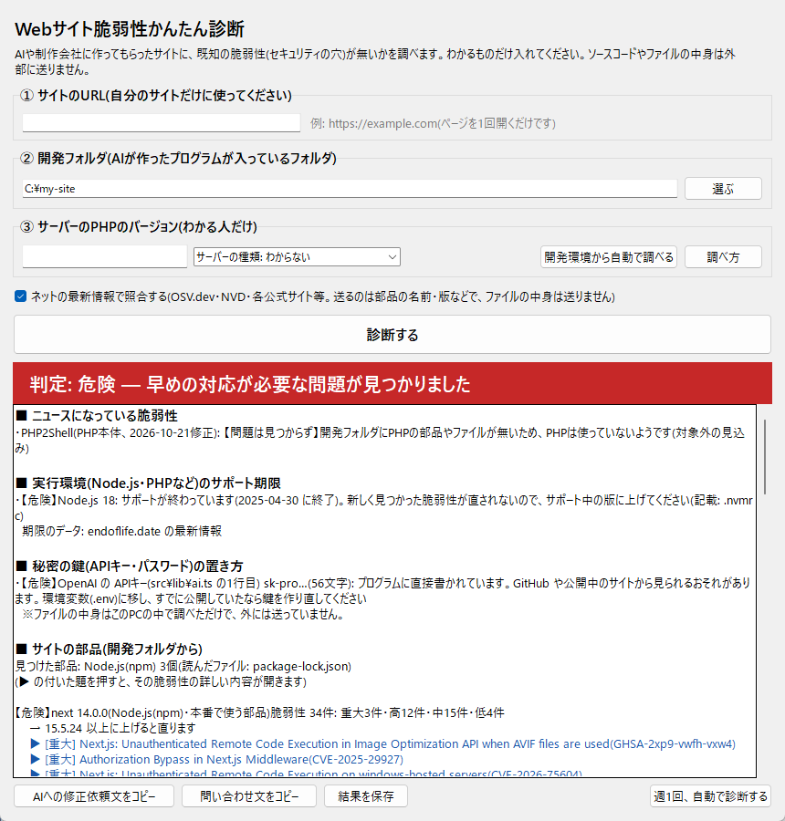

# Webサイト脆弱性かんたん診断

AI や制作会社に作ってもらったWebサイトに、**すでに知られている脆弱性(セキュリティの穴)が無いか**を、専門知識が無くても調べられる Windows 用の無料ツールです。



## ダウンロード

**[最新版の WebShindan.exe をダウンロード](https://github.com/An-Takatuki/web-shindan/releases/latest/download/WebShindan.exe)**

- インストールは不要です。ダウンロードした `WebShindan.exe` をダブルクリックすると起動します。
- 使い方は **[ユーザーマニュアル(PDF)](https://github.com/An-Takatuki/web-shindan/releases/latest/download/WebShindan_manual.pdf)** をご覧ください。
- 過去の版や変更点は [Releases](https://github.com/An-Takatuki/web-shindan/releases)(リリース一覧)にあります。

### 起動する前に、本物か確かめてください

このツールには「デジタル署名」がありません。ダウンロードしたファイルが途中で書き換えられていないか、PowerShell で次を実行して確かめてください。

```powershell
Get-FileHash .\WebShindan.exe
```

表示された `Hash` が、[Releases](https://github.com/An-Takatuki/web-shindan/releases) の各版に書いてある **SHA-256** と一致すれば本物です。一致しない場合は起動せずに削除してください。

### 警告が出たとき

署名が無いため、Windows やウイルス対策ソフトが警告を出すことがあります(上で本物と確かめてから進めてください)。

- 「Windows によって PC が保護されました」→「詳細情報」→「実行」
- Windows セキュリティに止められた →「ウイルスと脅威の防止」→「保護の履歴」で「許可」または「復元」
- 除外の設定が必要な場合は、**`WebShindan.exe` のファイル1つだけ**を除外してください(フォルダごとの除外はしないでください)

## できること

| 入れるもの | わかること |
|---|---|
| ① サイトのURL | 何で動いているか・置き場所の推定、HTTPS と証明書の期限、あると安心なセキュリティの設定 |
| ② 開発フォルダ | 部品(npm・Composer・Python・Ruby・Go・Rust)の既知の脆弱性と直る版、実際に攻撃に使われているか、Node.js・PHP などのサポート期限と最新の修正、WordPress 本体とプラグイン、秘密の鍵(APIキー等)の危ない置き方 |
| ③ PHPのバージョン | ニュースになった脆弱性「PHP2Shell」の対象か、最新の修正を取り込んでいるか |

ほかに、**AI にそのまま貼れる修正依頼文**・制作会社への問い合わせ文の作成、**前回からの変化**の表示、**週1回の自動診断**(新しい問題が見つかった時だけお知らせ)ができます。

## 調べられないこと

- サイトのプログラム自体の欠陥(SQLインジェクション等)— 攻撃のような通信が必要なため行いません
- WordPress プラグインの古い版の具体的な脆弱性、サーバーの中の設定、形でわからない秘密
- データベースに載る前の、公開されたばかりの脆弱性

## 外に送る情報

- 部品の名前と版(OSV.dev)、CVE番号(NVD)、WordPress のプラグイン名(WordPress.org)、入力したサイトへの1回のアクセス
- **ソースコードやファイルの中身、見つけた鍵は外に送りません。**
- 前回の結果は、この PC の `%LOCALAPPDATA%\WebShindan` にだけ保存します(鍵の値は保存しません)。

## 動作環境

- Windows 11(動作確認済み)。Windows 10 は未確認です。Mac・Linux には対応していません。
- 照合にはインターネット接続が必要です。

## 免責事項

- 結果は公開データベース等と照合した**目安**で、サイトの安全・危険を保証するものではありません。
- このツールの利用、または結果にもとづく作業によって生じた損害について、作者は責任を負いません。
- **ご自身が管理する(または許可を得た)サイトとフォルダだけ**に使ってください。
- 無料で提供しており、動作の保証・個別のサポートはありません。

詳しくはユーザーマニュアルの「2. ご利用の前に必ずお読みください」をご覧ください。

## 使っているデータ

[OSV.dev](https://osv.dev/) / [NVD](https://nvd.nist.gov/) / [CISA KEV](https://www.cisa.gov/known-exploited-vulnerabilities-catalog) / [endoflife.date](https://endoflife.date/) / [php.net](https://www.php.net/) / [nodejs.org](https://nodejs.org/) / [go.dev](https://go.dev/) / [WordPress.org](https://wordpress.org/)

## 開発者向け

- Python 3.12 の標準ライブラリだけで動きます(追加の部品はありません)。
- 起動: `python main.py`
- exe の作成: `build.bat`(PyInstaller が必要: `python -m pip install pyinstaller`)。`dist\WebShindan.exe` に出力されます。

## 作者

- GitHub: [An-Takatuki](https://github.com/An-Takatuki)
- X: [@An_Takatuki](https://x.com/An_Takatuki)

## ライセンス

[MIT License](LICENSE)
